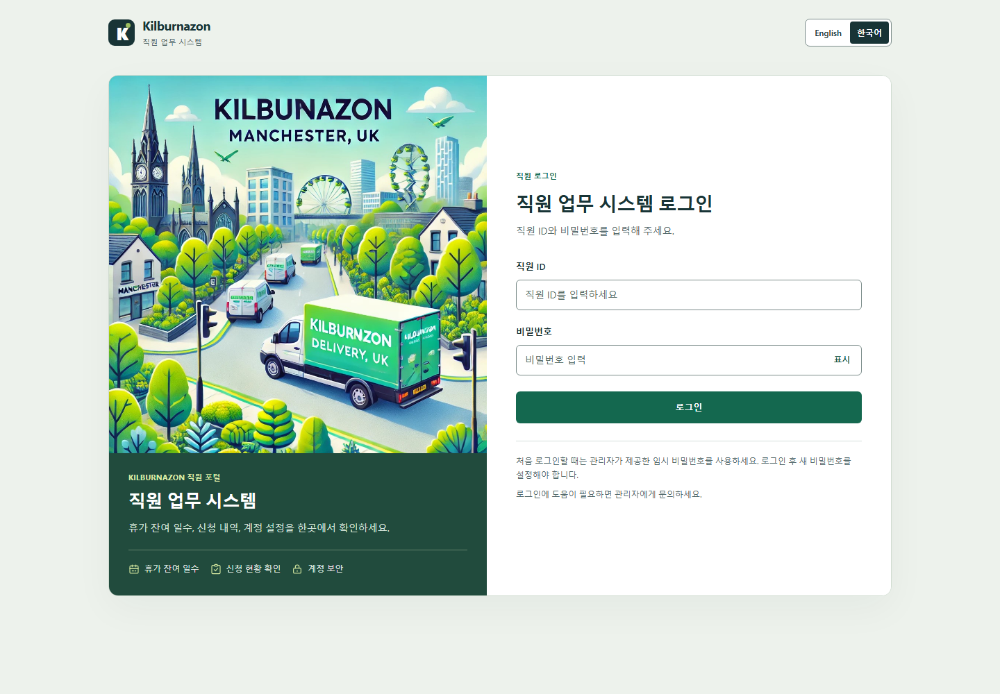

<a href="README.md">English</a> | <strong>한국어</strong>

# Kilburnazon 인사 관리 시스템

PHP와 MySQL로 직원 정보, 휴가 신청 및 승인, 월별 부재 현황, 급여 보고서와 삭제 기록을 관리하는 웹 애플리케이션입니다. 직원은 자신의 휴가와 계정을 관리하고, Executive 부서 사용자는 인사 관리 기능을 이용합니다. 직원 197명의 제공 데이터는 과제용 가상 데이터입니다.

프레임워크 없이 PHP 페이지에서 요청을 처리하는 구조와 업무 기능, 데이터 및 Git 이력은 유지했습니다. 공통 보안 검사와 회귀 테스트를 추가했으며, 초기 구현은 별도의 실행 가능한 사본 대신 Git 이력에서 확인할 수 있습니다.

| 기능 | 처리 방식 |
| --- | --- |
| 로그인 | 계정마다 다른 임시 비밀번호, 최초 변경 의무화, 반복 실패 제한, 로그인 시 세션 ID 재발급 |
| 접근 권한 | 요청마다 현재 계정과 Executive 소속을 조회하고 인증 버전으로 폐기된 세션 차단 |
| 직원 관리 | 자동 ID 발급, 직원과 연락처 및 계정의 일괄 저장, 변경 버전 검사로 오래된 화면의 덮어쓰기 방지 |
| 휴가 | 본인의 신청만 허용하고 달력 기준으로 일수 계산, 저장된 신청과 잔여 일수를 확인해 한 번만 차감 |
| 보고서 | 월 경계에 걸친 휴가를 해당 월에 나눠 집계하고 연간, 분기, 월 급여와 CSV 제공 |
| 삭제 기록 | 저장 프로시저가 트랜잭션 안에서 직원 정보의 사본을 남긴 뒤 삭제 |

관리자 권한은 Executive 부서 소속을 기준으로 부여합니다. 규모가 커지면 업무 조직과 별도의 권한 체계가 필요합니다. 급여 계산은 과제의 계산식을 유지했으며 실제 세무나 급여 정산을 위한 시스템은 아닙니다.

## 화면 언어 선택

애플리케이션과 저장소는 **영어를 기본**으로 제공합니다. 화면 상단에서 **한국어**를 누르면 한국어로, **English**를 누르면 영어로 전환할 수 있습니다. 선택한 언어는 페이지를 이동하거나 로그인한 뒤에도 유지합니다. 저장하지 않은 입력이 있으면 언어를 바꾸기 전에 확인합니다.

기본 [영문 소개](README.md)와 한국어 설명 문서는 분리해 제공합니다. 직원 이름과 원본 업무 데이터는 그대로 유지하며 CSV의 열 제목도 기존 영어 형식을 유지합니다. 한국어 화면은 실제 기능에 맞는 인사 업무 용어를 사용합니다.

## 화면과 주요 사용 흐름

공통 메뉴, 글꼴과 간격을 적용하고 PC와 모바일에서 같은 흐름으로 사용할 수 있도록 정리했습니다. 관리자는 방해되는 팝업 없이 직원 수와 대기 중인 신청을 확인하고, 일반 직원은 자신의 잔여 휴가와 최근 처리 내역을 확인합니다.

- 직원 이름이나 이메일로 검색하고 부서, 직책 및 사무실 필터를 함께 사용할 수 있습니다. 목록은 12명씩 표시하며 페이지를 바꿔도 필터를 유지합니다. 검색어의 퍼센트와 밑줄은 일반 문자로 처리합니다.
- 직원 프로필의 **Edit employee**에서 해당 직원의 수정 화면으로 바로 이동합니다. 부서를 선택하면 관련 직책을 보여주며 서버의 소속 및 변경 버전 검사는 그대로 적용합니다.
- 휴가를 보내기 전에 시작일과 종료일을 포함한 달력 일수와 승인 후 예상 잔여량을 확인합니다. 미리보기와 별도로 서버 검사와 관리자 승인을 거칩니다.
- 비밀번호 표시 전환, 삭제 등의 확인 절차와 중복 제출 방지를 추가했습니다. 작은 화면에서는 넓은 표만 패널 안에서 가로로 스크롤합니다.

자세한 내용은 [UI 및 사용성 검증 문서](docs/INTERFACE.ko.md)에 정리했습니다. 권한, CSRF, 트랜잭션과 급여 계산식 및 초기 Git 이력은 유지합니다.

## 로컬 실행

지원 중인 PHP와 MySQL의 최신 보안 패치를 사용하세요. 검증 기준은 **PHP 8.5.12의 Windows 패키지 8.5.12-1**, MySQLi 확장, **MySQL 8.4.13 LTS**입니다. Windows 패키지 재배포 번호는 `php -v`에 표시되지 않으므로 공급자의 패키지 정보도 확인해야 합니다. [보안 및 검증 문서](docs/SECURITY.ko.md)에 기준일과 확인 범위를 정리했습니다.

1. 저장소를 내려받고 로컬 MySQL을 준비합니다. `.env.example`을 저장소 루트의 `.env`로 복사합니다. 스키마 설정용 `DB_SETUP_*` 계정과 실행용 `DB_*` 계정에 서로 다른 비밀번호를 지정합니다. 실행 계정의 root 사용과 빈 비밀번호는 거부합니다. 프로세스 환경 변수가 `.env`보다 우선합니다.
2. [데이터베이스 가이드](database/README.ko.md)에 따라 가상 데이터를 생성하고 제한된 실행 계정을 준비합니다. 기존 데이터베이스는 다시 시드하지 않고 마이그레이션합니다.
3. 저장소 루트에서 실행합니다.

   ~~~sh
   php -d session.upload_progress.enabled=0 -d display_errors=0 -S 127.0.0.1:8000 -t public
   ~~~

4. [http://127.0.0.1:8000](http://127.0.0.1:8000)에 접속합니다. 설정 명령이 출력한 경로의 **비공개 임시 비밀번호 JSON**에서 직원 ID와 개별 비밀번호를 확인합니다. 이 파일은 Git에 포함되지 않습니다. 처음 로그인하면 15자 이상의 비밀번호로 변경해야 합니다. 공통 초기 비밀번호는 없습니다. 화면에서 추가한 직원의 임시 비밀번호는 관리자에게 한 번만 표시합니다.

PHP 내장 서버는 로컬 개발용입니다. 실제 배포에서는 HTTPS를 적용하고 **`public/`만** 웹 루트로 지정해야 합니다. `.env`, `var/`, 설정 및 테스트 파일을 공개하지 마세요. `APP_ORIGIN`에는 실제 접속 주소를 정확히 설정하고 HTTPS 프록시를 사용할 때는 TLS 전달 설정을 확인해야 합니다. `session.upload_progress.enabled=0`은 요청 내부가 아닌 서버 시작 설정에 적용합니다. 이 프로젝트의 검증이 실제 인사 시스템의 운영 보안을 인증하는 것은 아닙니다.

## 실행 검증

Python 3.10 이상과 이름이 **`_test`로 끝나는 폐기 가능한 데이터베이스**가 필요합니다. 별도의 환경이나 셸에서 설정하세요. 테스트는 가상 직원을 생성하고 제거하므로 실제 업무 데이터베이스를 지정하면 안 됩니다.

~~~sh
# DB_NAME=company_regression_test와 새 DB_USER=company_regression_app을 지정합니다.
# 기존 설치 계정과 다른 DB_PASSWORD 및 설정용 DB_SETUP_*도 준비합니다.
php scripts/setup.php
php scripts/create-runtime-user.php
python tests/security_regression.py
~~~

`PHP_BIN`으로 PHP 실행 파일을 지정할 수 있고, `PHP_ARGS_JSON`으로 확장 모듈 설정 등의 옵션을 JSON 배열로 전달할 수 있습니다. 결과와 서버 로그는 Git에서 제외한 `var/`에 저장합니다. 테스트가 자체 로컬 서버를 시작하고 종료합니다. 실제 결과와 검증 한계는 [검증 문서](docs/SECURITY.ko.md)를 참고하세요.

## 폴더 구성

| 경로 | 역할 |
| --- | --- |
| `public/` | 유지한 18개 PHP 엔드포인트와 정적 자산, 유일한 웹 루트 |
| `config/` | 환경 설정, DB 연결, 계정 및 권한 재확인, 세션과 CSRF 등의 공통 처리 |
| `lib/` | 업무 입력 검증, 공통 화면과 영어 및 한국어 표시 |
| `database/` | 가상 데이터, 스키마, 마이그레이션, 트리거와 삭제 프로시저 |
| `scripts/` | CLI 전용 설정, 마이그레이션 및 실행 계정 준비 |
| `tests/` | 별도 테스트 DB를 이용한 HTTP 및 데이터 무결성 검증 |
| `docs/` | [구조 문서](docs/ARCHITECTURE.ko.md)와 [보안 문서](docs/SECURITY.ko.md)의 영어 및 한국어 버전 |
| `var/` | Git에서 제외한 비공개 비밀번호 파일, 로그 및 테스트 결과 |

`login`은 로그인 성공 이력이 아닌 비밀번호 해시 저장소입니다. `login_attempts`는 반복 실패를 제한하기 위한 기록이며 영구 감사 로그가 아닙니다. `delete_employee_logs`는 직원 삭제 내역을 보관합니다. 3년이 지난 기록은 CSRF 검사를 거치는 명시적인 정리 버튼으로 제거하며 보고서를 열기만 해서는 삭제되지 않습니다.

상거래와 배송 관련 선택 과제는 인사 관리 UI와 분리해서 유지합니다. [Git 이력](https://github.com/Dongmyung378/Company-Website-Assignment/commits/main/)에서 초기 코드와 변경 과정을 확인할 수 있습니다.
