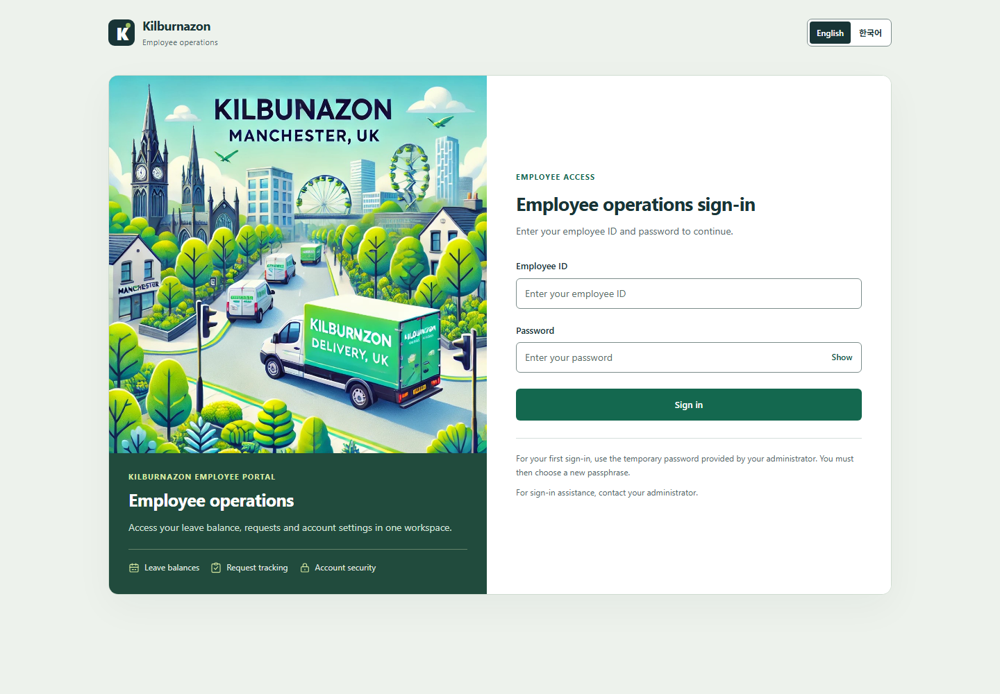

<strong>English</strong> | <a href="README.ko.md">한국어</a>

  
  <h1>Kilburnazon People Operations</h1>
  
A server-rendered PHP and MySQL employee operations application.

## What it does

Employees can request annual, sick or personal leave, check their request history and change their password. Executive users maintain employee and emergency-contact records, approve leave, review monthly absence and birthdays, export payroll reports and inspect deletion records. The supplied 197 employee records are fictional coursework data.

The project keeps its original framework-free page structure, business features, dataset and Git history. Shared security checks and regression tests support the same workflows. The historical implementation remains in Git history rather than a second executable application.

| Workflow | Implementation |
| --- | --- |
| Sign-in | Individual temporary credentials, mandatory first password change, failure throttling and renewed session IDs |
| Access control | Each request reloads current Executive membership and verifies the account credential version |
| Employee records | Automatic IDs, atomic employee/contact/account creation, and stale-update version checks |
| Leave | Session-owned requests and calendar-day counting; locked approval deducts sufficient balance once |
| Reports | Monthly overlap calculation, annual/quarterly/monthly payroll, and formula-neutralized CSV text |
| Deletion | A transaction-owning stored procedure records a full-width snapshot before employee removal |

Authorization follows Executive department membership. A separate permissions model would suit a larger HR system. Payroll preserves the coursework calculation; it is not a legal payroll or tax engine.

## Interface language

**English is the default** for the application and this repository. Use the **한국어** control in the page header to switch to Korean; choose **English** to switch back. The preference is remembered across pages and sign-in. Unsaved form entries are protected by a confirmation before changing language.

The [Korean overview](README.ko.md) and matching Korean guides are provided separately. Proper names and stored business values remain intact; CSV exports keep their original English headers. The Korean interface uses reviewed HR terminology rather than literal word substitution.

## Using the workspace

Every page uses the same navigation, typography and responsive layout. The administrator overview shows current employee counts and pending requests without interrupting alerts. Employees see their own balances and recent leave decisions.

The original Kilburnazon company illustration appears in full on the sign-in page and both overviews. Navy and dark green, a soft sage background, and consistently spaced white panels connect the interface to that image. Text stays on separate surfaces rather than covering the artwork. On mobile, sign-in controls come before the illustration.

- Search the directory by name or email, combine department/position/office filters, and browse 12 employees per page. Search treats percent signs and underscores literally; filters remain in page links.
- Open an employee profile and choose **Edit employee** to load the matching record. Position choices follow the selected department; the server still verifies the assignment and record version.
- Preview inclusive calendar days and the balance remaining after approval before submitting leave. This is a preview; the server and administrator approval remain authoritative.
- Show or hide password fields, receive confirmation before destructive actions, and avoid duplicate form submission. Tables scroll inside their panels on small screens.

See [interface and verification notes](docs/INTERFACE.md). The visual changes do not replace authorization, CSRF, transactions, payroll formulas or the initial Git history.

## Run locally

Use supported, patched PHP and MySQL releases. The validation baseline is **PHP 8.5.12, Windows package 8.5.12-1**, with MySQLi, and **MySQL 8.4.13 LTS**. Windows package rebuild suffixes are not shown by `php -v`; obtain the latest vendor-patched package. See the dated [security and verification notes](docs/SECURITY.md).

1. Clone this repository and prepare a local MySQL server. Copy `.env.example` to `.env` at the repository root. Use separate, nonempty credentials for the trusted schema account (`DB_SETUP_*`) and restricted application account (`DB_*`). Runtime root and empty passwords are rejected. Process environment variables override `.env`.
2. Follow the [database guide](database/README.md) to initialize fictional data, create the runtime user and migrate an existing installation without reseeding it.
3. Start the local development server from the repository root:

   ~~~sh
   php -d session.upload_progress.enabled=0 -d display_errors=0 -S 127.0.0.1:8000 -t public
   ~~~

4. Open [http://127.0.0.1:8000](http://127.0.0.1:8000). Setup prints the path to a **private, ignored credentials JSON**. Use the employee ID and its unique temporary password from that local file, then choose a passphrase of at least 15 characters. There is no shared default password. An administrator creating an employee receives the temporary password once on the creation screen.

PHP's built-in server is for local development. Real deployment requires HTTPS with **only `public/`** as the web root. Keep `.env`, `var/`, database scripts and tests private. Set `APP_ORIGIN` to the exact origin and configure any TLS proxy correctly. Set `session.upload_progress.enabled=0` in server startup configuration, not only inside a request. This educational project's checks do not certify a production HR deployment.

## Verify the application

The harness needs Python 3.10+ and a **disposable database whose name ends in `_test`**. Use a separate environment or shell: tests create and remove synthetic fixtures and must never target a live database.

~~~sh
# Use a disposable DB_NAME=company_regression_test and a NEW DB_USER=company_regression_app.
# Set a distinct DB_PASSWORD and the trusted DB_SETUP_* credentials first.
php scripts/setup.php
php scripts/create-runtime-user.php
python tests/security_regression.py
~~~

`PHP_BIN` selects a PHP executable. `PHP_ARGS_JSON` optionally supplies a JSON array of PHP options, including extension settings for portable runtimes. Ignored `var/` contains results and server logs. The harness starts its own loopback HTTP server and stops it after the run. See [verification details](docs/SECURITY.md) for coverage, results and limitations.

## Repository map

| Path | Purpose |
| --- | --- |
| `public/` | The existing 18 PHP endpoints and assets; the only web root |
| `config/` | Environment loading, connection, current-account guards, CSRF, sessions and security helpers |
| `lib/` | Workflow validation, shared layout and English/Korean display helpers |
| `database/` | Fictional seeds, schema, migrations, triggers and the deletion procedure |
| `scripts/` | CLI-only setup, migration and runtime-user provisioning |
| `tests/` | HTTP and database regressions for an explicitly disposable database |
| `docs/` | [Architecture](docs/ARCHITECTURE.md) and [security/verification](docs/SECURITY.md), both with Korean versions |
| `var/` | Ignored private credentials, logs and test output; never publish it |

`login` stores credential hashes. `login_attempts` contains expiring failure-throttling records, not a permanent successful-login audit. `delete_employee_logs` records employee deletions. Removing records older than three years is an explicit CSRF-protected action; viewing the report never deletes data.

Optional commerce/delivery exercises remain separate from the employee UI. All earlier commits remain in the [repository history](https://github.com/Dongmyung378/Company-Website-Assignment/commits/main/).
